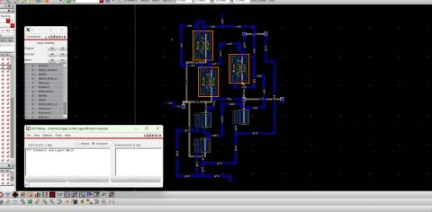

# CMOS Schmitt Trigger — Cadence Virtuoso

A transistor-level CMOS Schmitt trigger designed and simulated in Cadence Virtuoso. This project documents the schematic, symbol, transient and power analyses, layout, physical-verification results, and extraction workflow.

## Project Status

| Item | Status |
|---|---|
| Schematic | Included |
| Symbol view | Included |
| Transient analysis | Included |
| Power analysis | Included |
| Layout | Included |
| DRC | Completed (screenshot included) |
| LVS | Matched (screenshot included) |
| QRC extraction / extracted view | Completed by project author; extracted view will be uploaded separately |

## 1. Schematic

The transistor-level circuit implements a Schmitt trigger, a comparator-like circuit with hysteresis. Hysteresis provides different switching thresholds for rising and falling input signals, improving noise immunity when the input changes slowly or contains noise.

## 2. Symbol View

The symbol exposes the input, output, supply, and ground connections for use in higher-level schematics.

## 3. Transient Analysis

The transient plot shows the applied input waveform and the corresponding output switching response.

## 4. Power Analysis

The power-analysis plot is included as a simulation record. Numerical power values should be added only after confirming them from the Cadence calculator/results.

## 5. Layout

The physical layout corresponding to the schematic is shown below.

## 6. Physical Verification

### Design Rule Check (DRC)

The provided screenshot records DRC completion.

### Layout Versus Schematic (LVS)

The provided screenshot records an LVS match between the layout and schematic.

## 7. QRC Extraction

QRC extraction has been completed and an extracted view is available. The extracted view/database will be uploaded separately because it is not part of the screenshots in this folder. Add post-layout simulation plots here when available, and clearly distinguish pre-layout and extracted-view results.

## Tools and Concepts

- **EDA:** Cadence Virtuoso
- **Circuit:** CMOS Schmitt trigger
- **Analyses:** Transient and power analysis
- **Physical design checks:** DRC and LVS
- **Parasitic extraction:** QRC; extracted view available separately

## Notes

This folder contains documentation screenshots, not the native Cadence library/cell database, technology files, netlists, or extraction setup. Reproducing the design requires the corresponding Cadence project files and PDK.
