<div align="center">

# Cadence Basics — CMOS Logic Design

**CMOS Inverter · NAND Gate · NOR Gate · Schmitt Trigger**

*A visual collection of transistor-level schematics and simulation results created in Cadence Virtuoso.*


</div>

---

## Overview

This repository documents foundational CMOS digital-design exercises using Cadence Virtuoso. It organizes the supplied schematic and simulation screenshots into three learning areas:

1. **CMOS Inverter** — transistor-level schematic, DC transfer characteristic, and transient response.
2. **CMOS NAND / NOR Gates** — transistor-level schematics and transient-response plots.
3. **Simulation review** — compare input waveforms with the output to inspect logic functionality.

> **Note:** This repository contains the screenshots provided for documentation. The original Cadence design databases, technology files, netlists, and simulation setup files were not included, so the circuits are not directly reproducible from screenshots alone.

## Repository Structure

```text
cadence-basic/
├── README.md
├── 01-CMOS-Inverter/
│   └── images/
│       ├── inverter-schematic.jpeg
│       ├── inverter-dc-transfer-characteristic.jpeg
│       └── inverter-transient-response.jpeg
└── 02-CMOS-NAND-NOR/
    └── images/
        ├── nand-gate-schematic.jpeg
        ├── nor-gate-schematic.jpeg
        ├── nand-transient-response.jpeg
        └── nor-transient-response.jpeg
```

## 1. CMOS Inverter

A CMOS inverter uses a PMOS pull-up transistor and an NMOS pull-down transistor. The output is the logical complement of the input.

### Transistor-Level Schematic

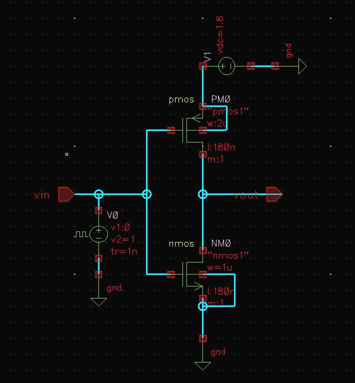

### DC Transfer Characteristic

The DC sweep shows how the output voltage changes as the input voltage is swept from low to high. The steep transition region indicates the inverter's switching region.

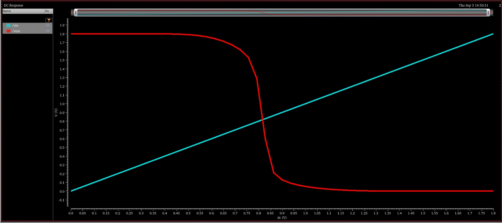

### Transient Response

The transient simulation compares the input and output over time. The output is expected to switch to the opposite logic level as the input changes, with practical propagation delay at transitions.

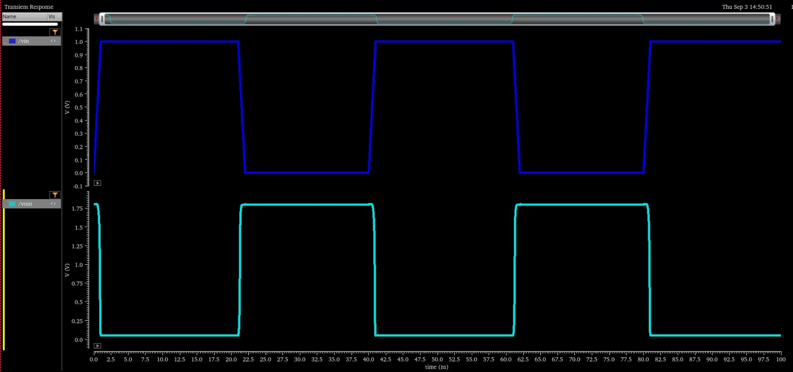

## 2. CMOS NAND and NOR Gates

NAND and NOR gates are universal logic building blocks. Their CMOS implementations use complementary PMOS pull-up and NMOS pull-down networks.

### NAND Gate — Schematic

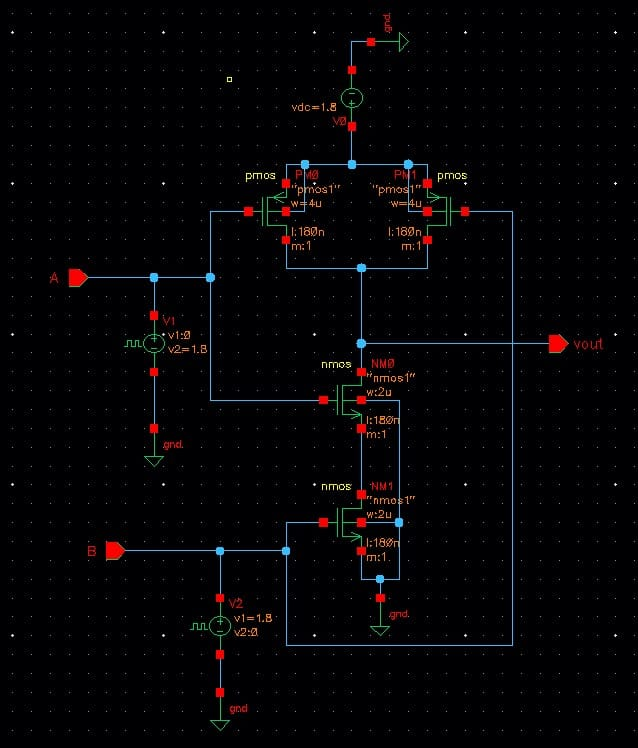

### NOR Gate — Schematic

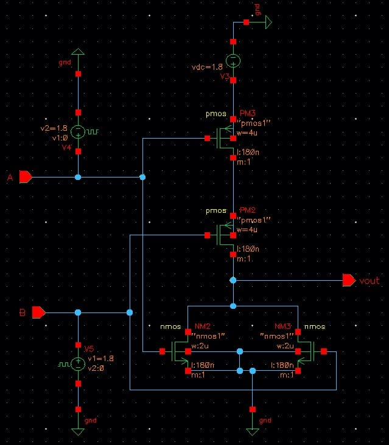

### NAND Gate — Transient Response

Use the input and output waveforms to verify the NAND truth-table behavior: the output is LOW only when both inputs are HIGH.

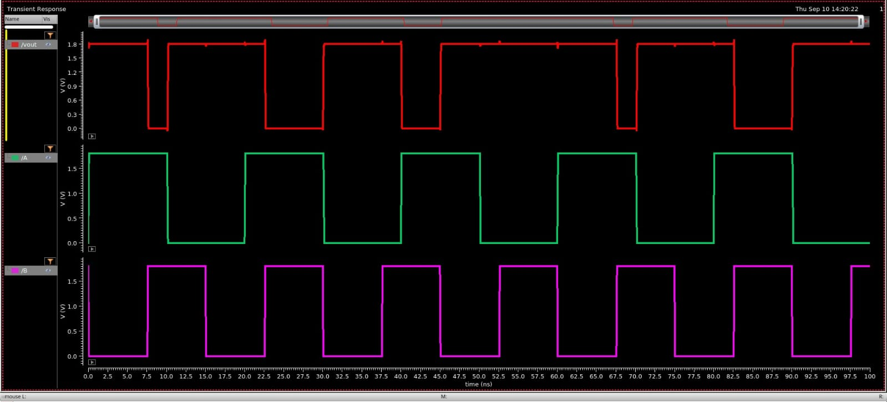

### NOR Gate — Transient Response

Use the input and output waveforms to verify the NOR truth-table behavior: the output is HIGH only when both inputs are LOW.

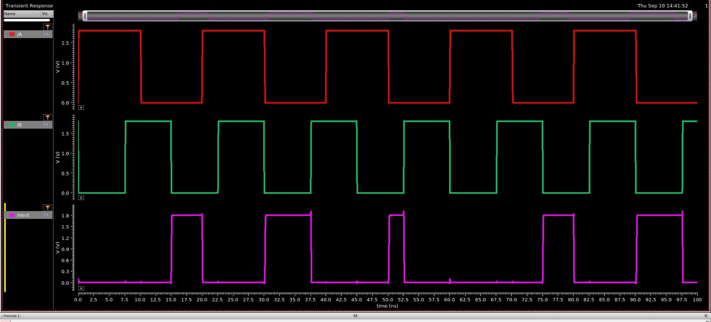

## Logic Truth Tables

### NAND

| A | B | Y = ¬(A · B) |
|:-:|:-:|:------------:|
| 0 | 0 | 1 |
| 0 | 1 | 1 |
| 1 | 0 | 1 |
| 1 | 1 | 0 |

### NOR

| A | B | Y = ¬(A + B) |
|:-:|:-:|:------------:|
| 0 | 0 | 1 |
| 0 | 1 | 0 |
| 1 | 0 | 0 |
| 1 | 1 | 0 |

## Tools and Concepts

- **EDA:** Cadence Virtuoso
- **Design level:** Transistor-level CMOS
- **Topics:** PMOS/NMOS operation, pull-up and pull-down networks, DC transfer curves, transient analysis, digital logic verification

## Suggested Next Steps

- Add the Cadence schematic/layout source files if they can be shared.
- Record the process node, supply voltage, transistor dimensions, and simulation conditions for each circuit.
- Add measured propagation delay, rise/fall time, and static power where available.
- Include DRC/LVS reports if physical layouts are completed.

---

<div align="center">

**Learning CMOS design one building block at a time.**

</div>


## 3. CMOS Schmitt Trigger

A transistor-level CMOS Schmitt trigger with schematic and symbol views, transient and power-analysis screenshots, layout, DRC/LVS evidence, and QRC extraction documentation. The extracted view itself will be added separately.

### Schematic

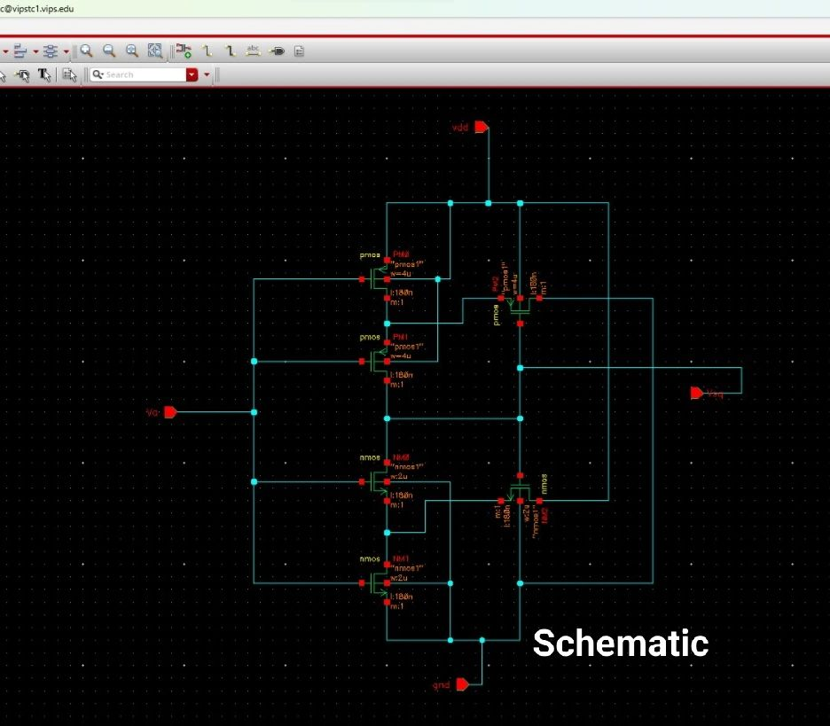

### Symbol

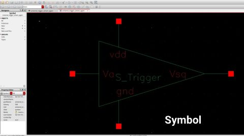

### Transient and Power Analysis

| Transient response | Power analysis |
|---|---|
| 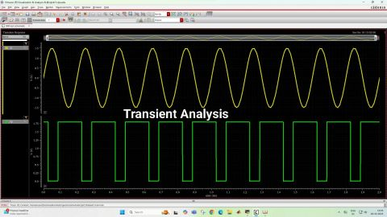 | 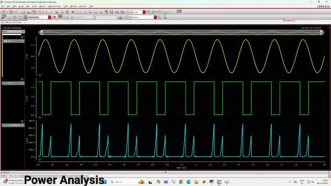 |

### Layout and Verification

| Layout | DRC completed | LVS matched |
|---|---|---|
| 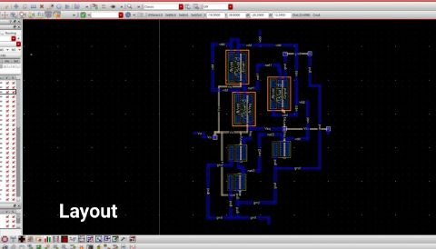 | 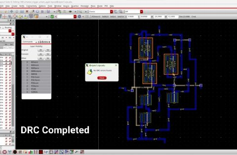 | 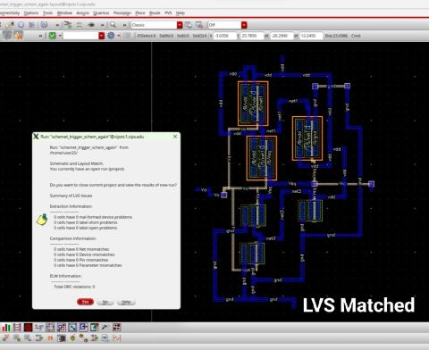 |

**QRC:** 

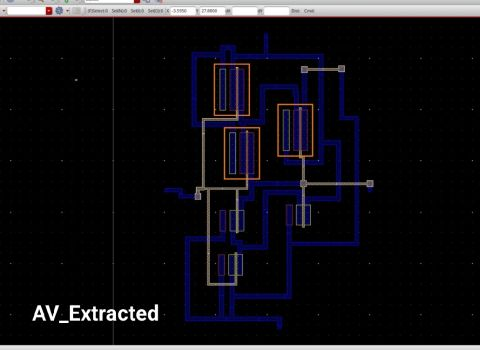
